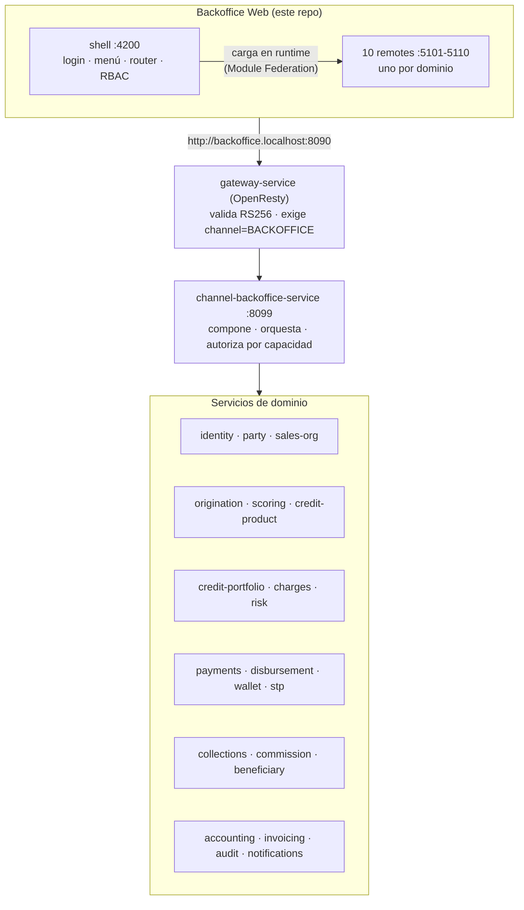
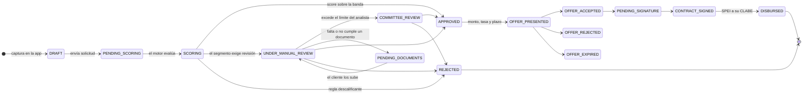
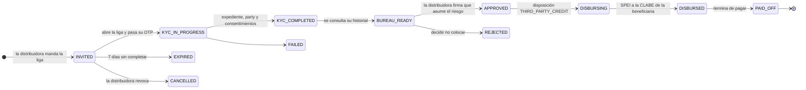
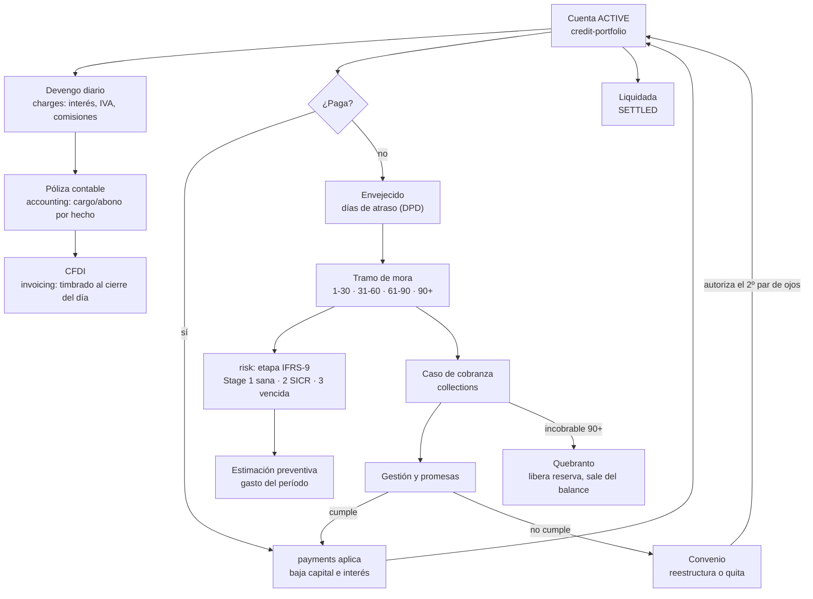
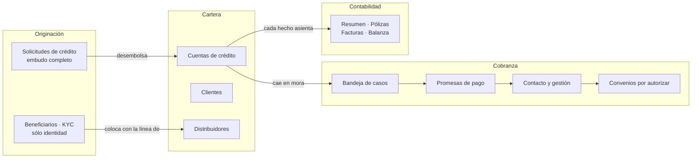

# Kredius — Backoffice de Crédito

Consola operativa para originar, seguir y cobrar crédito, sobre el backend `fintech-services`.
Monorepo **Nx + React + TypeScript + Vite + Module Federation**: un **shell** que compone y un
**remote por dominio**, con librerías compartidas.

- **Un solo camino a los datos:** `web → gateway → BFF → servicios`. El navegador nunca llama a un
  servicio de dominio.
- **El menú lo decide el backend:** `GET /permissions/me` publica las capacidades y la consola se
  arma con ellas. Esconder un módulo la hace usable, no segura.
- **Sin datos, sigue funcionando:** el `api-client` trae un dataset simulado, así que la consola se
  navega entera sin backend.

---

## Arquitectura



El BFF compone con tres patrones, y usar el correcto es lo que evita el N+1: **detalle de una
entidad** (fan-out acotado), **lista dentro de un detalle** (consulta paginada en el servicio dueño
+ `/batch`), y **agregado que cruza todas las filas** (se agrega en la base del dueño, nunca en un
bucle del BFF).

---

## El flujo de un préstamo

Un crédito nace de dos formas distintas, y la consola las separa porque **lo que se valida en cada
una no es lo mismo**.

### 1 · Persona que pide para sí — el embudo completo



**Quién decide qué.** El motor de scoring aprueba o rechaza solo cuando la política del producto lo
permite; el resto va a una persona. `UNDER_MANUAL_REVIEW` y `COMMITTEE_REVIEW` son las dos colas
humanas, y la diferencia es el límite de firma, no el tipo de caso.

> **El proveedor biométrico no está conectado.** Mientras tanto, quien comprueba la identidad es un
> analista mirando los documentos: el expediente permite aceptar o rechazar cada archivo con su
> motivo, y ese dictamen **redacta** la petición de documentos o el motivo del rechazo. Lo normal
> ante un comprobante ilegible es `PENDING_DOCUMENTS`, no `REJECTED`: un documento malo no es un
> crédito negado.

### 2 · Beneficiario de una distribuidora — sólo KYC

La distribuidora tiene una línea y coloca crédito a terceros con ella. **La deuda queda con la
distribuidora**, no con la beneficiaria.



**La regla que ordena esta pantalla: validamos identidad, no riesgo.** El historial que ve la
distribuidora es informativo y **no bloquea** la colocación — quien decide es ella. Lo único que
detiene el depósito es una identidad sin comprobar, y por eso `identityStatus` va en columna aparte
del paso del proceso.

### 3 · Ya desembolsado — el ciclo de vida del crédito

Desde `DISBURSED` la solicitud deja de mandar y empieza a mandar **la cuenta**.



**Tres cosas que esta consola no deja confundir:**

- **Vencida es 90+ y nada más.** El tramo 31-90 es atraso temprano (SICR) y va con su propio
  nombre. Mezclarlos hacía que la misma cartera diera dos moras según la pantalla.
- **Una promesa no cambia el tramo ni libera reserva.** Suspende la escalada mientras esté vigente;
  al romperse, el caso retoma la estrategia que le tocaba por días de atraso.
- **El quebranto saca el activo del balance** y consume su estimación. Lo que se recupere después
  entra como ingreso, no como pago de cartera.

### 4 · Dónde se mira cada etapa



---

## Estructura

```
apps/
  shell/             host: login, menú por secciones, router, RBAC, remotes    :4200
  mfe-dashboard/     panorama: KPIs, salud IFRS-9, mezcla por producto         :5101
  mfe-portfolio/     cuentas de crédito: reparto por tramo + ficha completa    :5102
  mfe-clients/       clientes, negocios y distribuidores                       :5103
  mfe-products/      catálogo y tasas · políticas de scoring                   :5104
  mfe-applications/  solicitudes (embudo) · beneficiarios (KYC)                :5105
  mfe-salesorg/      estructura comercial: árbol, reasignación, configuración  :5106
  mfe-audit/         bitácora regulatoria                                      :5107
  mfe-rbac/          administración: usuarios · roles · permisos               :5108
  mfe-collections/   cobranza: casos, promesas, gestión, convenios, buró       :5109
  mfe-accounting/    contabilidad: resumen, pólizas, facturas, balanza         :5110
libs/
  design-system/    tema, componentes, tablas, indicadores, charts SVG
  shared-types/     contratos con el BFF
  api-client/       SDK tipado (modo simulado / en vivo)
  auth/             sesión, capacidades y guards
  commercial/       árbol de cartera y reasignación, compartidos entre módulos
```

Cada app lleva su propio README con lo que consume y **por qué está hecha así**:
[shell](apps/shell/README.md) ·
[dashboard](apps/mfe-dashboard/README.md) ·
[portfolio](apps/mfe-portfolio/README.md) ·
[clients](apps/mfe-clients/README.md) ·
[products](apps/mfe-products/README.md) ·
[applications](apps/mfe-applications/README.md) ·
[salesorg](apps/mfe-salesorg/README.md) ·
[audit](apps/mfe-audit/README.md) ·
[rbac](apps/mfe-rbac/README.md) ·
[collections](apps/mfe-collections/README.md) ·
[accounting](apps/mfe-accounting/README.md)

---

## Módulos, capacidades y endpoints

Cada remote consume **sólo** el BFF; la columna de servicios dice de dónde saca ese BFF los datos,
para saber qué levantar cuando algo viene vacío.

| Pantalla | Capacidad | Endpoints del BFF | Servicios detrás |
|---|---|---|---|
| **Panorama** | `dashboard.view` | `/dashboard/{summary,stats,commercial}` | credit-portfolio · sales-org |
| **Solicitudes de crédito** | `applications.view` · `.decide` · `.request-documents` | `/origination/applications[/{id}]`, `/decision`, `/request-documents`, `/documents-received`, `/documents[/{tipo}/file]` | origination · scoring · party |
| **Beneficiarios · KYC** | `beneficiaries.view` | `/beneficiaries/placements[/{id}]` | beneficiary · party |
| **Cuentas de crédito** | `portfolio.view` | `/portfolio[/{id}]`, `/dashboard/stats?groupBy=dpdBucket` | credit-portfolio · risk · payments |
| **Clientes · Distribuidores** | `clients.view` · `.assign-executive` | `/clients[/{id}]`, `/distributors[/{id}]`, `/executives` | party · commission |
| **Cobranza** | `portfolio.view` | `/collections/{cases,payment-promises,contact-attempts,agreements,bureau-reports,config}` | collections |
| **Producto** | `products.manage` para escribir | `/products[/{id}]`, `/scoring/{policies,rule-types}` | credit-product · scoring |
| **Contabilidad** | `accounting.view` · `.close` | `/accounting/{summary,periods,vouchers,trial-balance,loans,units}`, `/invoices`, `/billing-runs` | accounting · invoicing |
| **Estructura comercial** | `salesorg.view` · `.manage` | `/sales-org/**`, `/dashboard/commercial[/by-origin-unit]` | sales-org · credit-portfolio |
| **Usuarios** | rol `ADMIN` | `/staff[/{id}]` y sus verbos | identity · sales-org |
| **Roles · Permisos** | `permissions.view` · `.manage` | `/permissions/{roles,capabilities,matrix}` | identity |
| **Auditoría** | `audit.view` | `/audit/entries[/{id}]` | audit |
| **Buzón** (campana) | basta estar autenticado | `/notifications`, `/notifications/read-all` | notifications |

**Contratos** aparece apagada y con el rótulo *sin conectar*: hoy se leen dentro de la ficha de la
cuenta porque el BFF no publica una consulta de contratos por sí sola.

---

## RBAC: una sola matriz

`GET /permissions/me` decide qué módulos se pintan **y las mismas capacidades deciden qué contesta
el servidor**. No siempre fue así: las reglas del BFF eran una lista de roles escrita a mano —la
matriz por tercera vez— y las tres se separaron. Medido antes de arreglarlo, sobre cinco roles y
tres módulos: **11 de 15 combinaciones no coincidían**.

Hoy `SecurityConfig` pregunta a la matriz (`requires("portfolio.view")`) y los controladores
también. La única regla que no es una capacidad es `/permissions/me`: gatearla sería pedirle
capacidades a quien todavía no sabe cuáles tiene. La excepción es `/staff/**`, que el BFF gatea por
rol `ADMIN` — `NavItem` acepta `roles` para eso, en vez de inventar un permiso que nadie comprueba.

La pantalla **Permisos** cruza las dos fuentes —lo que identity declara y lo que el BFF aplica— y
marca con un aspa las celdas que no coinciden. Es la causa de los dos fallos más desconcertantes de
una consola: un botón que existe y responde 403, y una pantalla escondida a quien sí puede entrar.

### El menú, y por qué cada pantalla tiene ruta

Ocho secciones plegables. Con veintitantas pantallas, una columna plana obliga a leerla entera para
encontrar la balanza y no dice nada de cómo se relacionan.

Cada pantalla es una **ruta** (`/contabilidad/balanza`), no una pestaña sin dirección: es lo que
permite mandar el enlace de lo que estás viendo. La ruta se traduce a la `vista` que el remote abre,
y el shell la pasa **como prop, no como `key`** — remontar el módulo al cambiar de pantalla tiraría
lo que vale para todas, como el período contable.

### La sesión se renueva sola

El token vive quince minutos. Sin renovarlo, la consola devolvía al login a media tarea. Se resuelve
en `libs/api-client/src/lib/http.ts` por dos caminos que hacen falta los dos: **por adelantado**
cuando al token le queda menos de un minuto, y **reactivo** al recibir un 401. La renovación es de
**un solo vuelo** — seis refresh simultáneos contra un token que rota significan cinco rechazados y
la sesión cerrada.

---

## Cómo correr

### Sin backend (modo simulado, por defecto)

```bash
npm install
./run-dev.sh            # shell:4200 + remotes:5101-5110, vigilados: si uno cae, vuelve
# abre http://localhost:4200
```

### Contra el BFF real

```bash
VITE_API_MODE=live VITE_BO_API_URL=http://backoffice.localhost:8090 \
VITE_DEV_PASSWORD='…' ./run-dev.sh
```

Las variables van al proceso de **cada** remote, no sólo al del shell: cada uno empaqueta su copia
del `api-client` y lee su propio `import.meta.env`. Levantar sólo el shell en live deja los módulos
hablando con el dataset simulado, y la pantalla se ve bien mientras miente.

```bash
npm run env:up      # levanta los servicios que hacen falta y RECONSTRUYE el BFF
npm run types:gen   # regenera los tipos desde el OpenAPI del BFF
```

`env:up` existe por una razón concreta: dos veces se concluyó que un endpoint «no existía» cuando el
contenedor corría una imagen de días atrás. Antes de depurar un 404, correr esto.

### Usuarios de prueba

| Correo | Roles | Qué abre |
|---|---|---|
| `admin@kredius.mx` | ADMIN | todo, incluidos Usuarios, Roles y Permisos |
| `analista@kredius.mx` | CREDIT_ANALYST, RISK_ANALYST | solicitudes, beneficiarios, clientes, cuentas |
| `ejecutivo@kredius.mx` | EXECUTIVE | panorama, cuentas, clientes, estructura comercial |
| `comite@kredius.mx` | UNDERWRITER, COMMITTEE | panorama, solicitudes, clientes, cuentas |
| `producto@kredius.mx` | PRODUCT_MANAGER | panorama, producto |

Y un responsable por escalón del árbol comercial —`nacional@`, `region@`, `zona@`, `sucursal@`,
`ejecutivo.cul@`— todos con rol `EXECUTIVE`: el rol dice *qué* puede hacer y la unidad *sobre qué*.
En modo simulado la contraseña es cualquier valor; en vivo, la de los empleados sembrados.

> **Suspender a alguien no lo saca al instante.** El gateway valida la firma localmente y no
> consulta revocación, así que un token ya emitido sirve hasta que expira (≤15 min). El login y el
> refresh sí se bloquean de inmediato.

---

## Degradación por bloque

La ficha de análisis compone cinco fuentes. Si el buró está caído, el analista todavía puede leer el
score y decidir; perder la pantalla por un panel secundario convierte una degradación en una caída.
`<Block>` distingue cuatro situaciones y **ninguna es «error»**:

- **cargando** — todavía no se sabe.
- **vacío** — se sabe, y no hay nada.
- **fuera de alcance / falta unidad** — el backend contestó bien a una pregunta que no correspondía.
  Se explica, sin botón de reintentar: reintentar no cambia la respuesta.
- **error** — algo se rompió; se reintenta **ese** bloque.

`ApiError.kind` es lo que lo permite: `FORBIDDEN_SCOPE` (subárbol ajeno) y `UNIT_REQUIRED` (400 de
`/dashboard/commercial` sin `unitId`) se separan del 403 y el 400 genéricos.

---

## Federación: qué se comparte y por qué

`@bo/auth`, `@bo/api-client`, `@bo/design-system` y `@bo/shared-types` van como **singleton**: un
remote con su propia copia de `@bo/auth` no comparte el estado de capacidades.

El estado, además, no vive en un contexto de React sino en un store anclado a `globalThis`. Depender
sólo de `shared` resultó frágil en dev: el remote leía el valor por defecto —`can() => false`— y el
fallo no se veía como error, sino como botones de **Aprobar** y **Rechazar** que nunca aparecían
para quien sí tenía permiso.

---

## Verificación

```bash
npx tsc -b                                       # librerías: compila y refresca sus .d.ts
npx tsc -p apps/shell/tsconfig.json --noEmit     # y así cada app
npx nx run-many -t build --all                   # las 11 (genera remoteEntry.js)
```

El target `typecheck` de Nx está **deshabilitado** en este repo: las apps declaran `noEmit: true` y
Nx lo desactiva solo, así que `nx run-many -t typecheck` imprime un aviso y no comprueba nada.

`tsc -b` no es opcional antes de comprobar una app: las apps resuelven las librerías por sus
declaraciones compiladas, así que un export recién añadido a `@bo/api-client` no existe para ellas
hasta que se regenera. Añadir `--noUnusedLocals` encuentra importaciones muertas.

Las pruebas de navegador viven en [`tools/e2e`](tools/e2e/README.md).

---

## Estado

La consola consume **todo lo que el BFF publica** salvo
`GET /sales-org/assignments/{tipo}/{id}/current`, redundante con lo que el árbol ya pinta. Al revés
falta `POST /sales-org/units`: la red se puede reorganizar y configurar, pero no ampliar desde la
pantalla.

Lo que queda del lado del backend:

| Falta | Dueño | Efecto hoy |
|---|---|---|
| Contratos como consulta propia | BFF | Se leen dentro de la ficha de la cuenta |
| Dictamen por documento | origination + BFF | El expediente no guarda estado por archivo: el veredicto del analista redacta la acción, pero no queda por documento |
| Aprobar identidad de un beneficiario | beneficiary + BFF | Las colocaciones se publican en sólo lectura; `approve`/`reject` existen pero son del distribuidor |
| `actor` en las acciones de backoffice | BFF → audit | «Quién lo hizo» sólo tiene dato en login y aprobaciones |
| Paginación en `/audit/entries` | audit | La bitácora se trae completa en cada consulta |

Fuera de alcance por decisión: **Comisiones** se aborda por otra vía y **Configuración** ya existe
repartida en Usuarios, Roles y Permisos.
